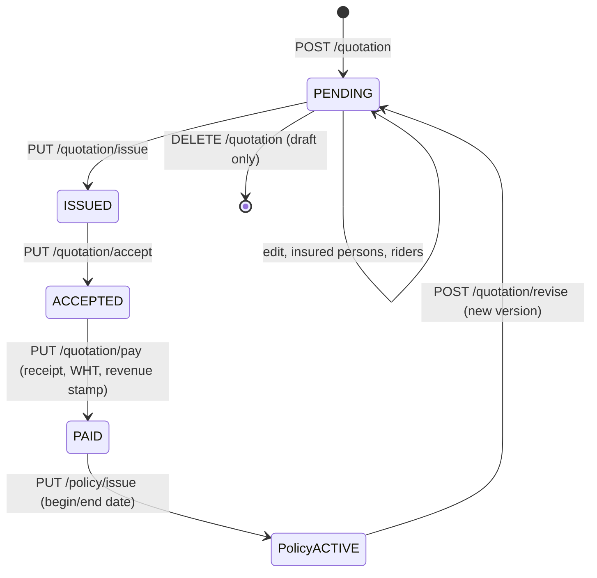
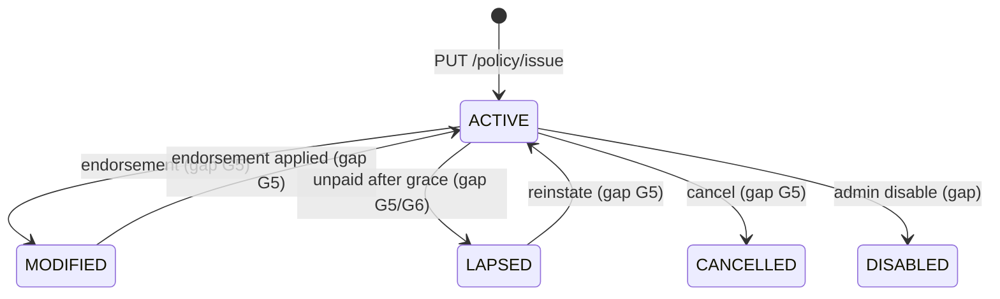
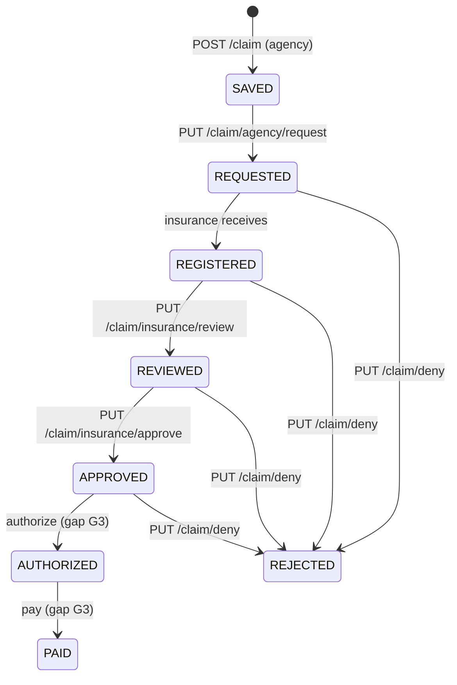

# 7 · Status lifecycle

Every status below is an enum in the OpenAPI document (`src/features/life/constants/statuses.js` mirrors them).
Transitions marked **(gap)** have no endpoint today and are requested in
[09-backend-gaps-and-change-requests.md](09-backend-gaps-and-change-requests.md).

## Group quotation → policy

| quotationStatus | Meaning | Who moves it | Next | Editable | Badge |
|---|---|---|---|---|---|
| PENDING | Draft being priced | Underwriter / sales | ISSUED | Yes: details, insured, riders | neutral |
| ISSUED | Sent to the client | Underwriter | ACCEPTED (client agreed) | No (revise instead) | info |
| ACCEPTED | Client accepted, awaiting payment | Underwriter / sales | PAID | No | warning |
| PAID | Premium received; ready to issue | Finance | policy issued | No | success |

## Policy (group, `policyStatus`)

| policyStatus | Meaning | Frontend actions | Badge |
|---|---|---|---|
| PENDING | Created but not in force | View | neutral |
| ACTIVE | In force | View, claim, revise/renew; endorse/cancel once G5 exists | success |
| MODIFIED | Change in progress | View | info |
| LAPSED | Cover suspended for non-payment | View; reinstate once G5 exists | warning |
| CANCELLED | Terminated | View only | danger |
| DISABLED | Administratively disabled | View only | neutral |

The backend has no EXPIRED/MATURED status for a term that has run out; expiry is inferred from `endDate`
until G5 adds it.

## Individual term policy ("benefit")

`ACTIVE | PENDING | RENEWED | DISABLED | LAPSED | CANCELLED`. Only create/update/delete exist; issue,
renew, lapse and cancel are gap G11/G5. Rider benefits use the same values plus a `paid` flag.

## Claim

Claim statuses are untyped strings; the stage is visible from which list returns the claim.

| Stage | Who | Action endpoint | Badge |
|---|---|---|---|
| Saved / Requested | Agency (employer HR, agent or branch) | `agency/request` | neutral / info |
| Registered → Reviewed | Claims officer | `insurance/review` | info |
| Reviewed → Approved | Claims manager | `insurance/approve` | warning |
| Approved → Authorized | Authorizer | **missing** | warning |
| Authorized → Paid | Finance | **missing** | success |
| Rejected (any stage) | Reviewer/approver | `deny` with reason | danger |

## Configuration records

| Enum | Used by | Values | Transition endpoint |
|---|---|---|---|
| Rider / rate status | rider, individual & group rider rates, individual term | ACTIVE, PENDING, MODIFIED, DISABLED, LAPSED, CANCELLED | `rider/activate`, `rider/replicate` (new PENDING version from ACTIVE) |
| Record status | question, group term rates, reinsurer | ACTIVE, PENDING, DISABLED | `reinsurer/update/status`; others via update |
| Treaty status | treaty, member, FCL group, medical parameter / range / requirement, policy–treaty mapping | ACTIVE, PENDING, REVISED | `…/update/status/{uuid}` on each |

## Badge colours (design tokens)

neutral → `bg-surface-raised text-ink-muted`, info → `bg-primary/10 text-primary`, success → `bg-success-soft
text-success-strong`, warning → `bg-warning-soft text-warning-strong`, danger → `bg-error-soft text-error-strong`.
